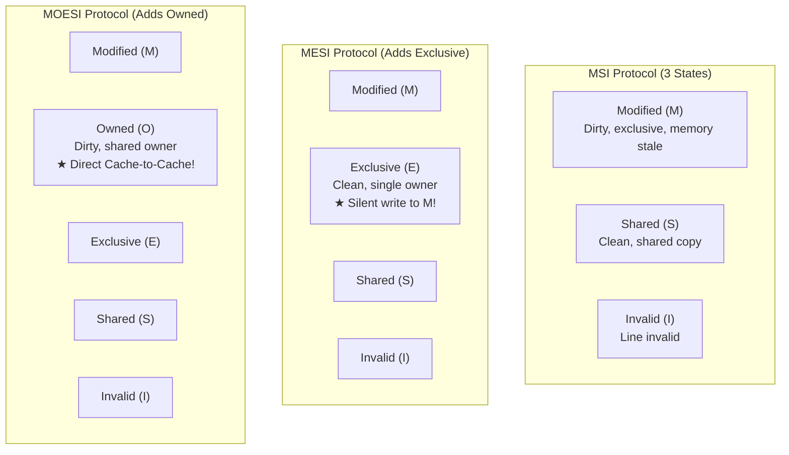
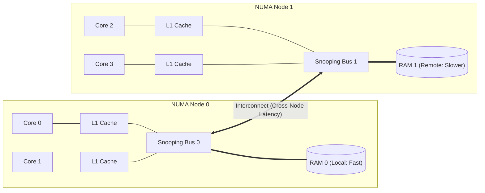

# Experiment 4: Analyze Cache Coherence (MSI, MESI, MOESI) and NUMA Memory Access Performance

- **Course:** Parallel & Distributed / GPU Computing Laboratory
- **Target OS:** Ubuntu 22.04 LTS (Hosted on VMware Workstation Pro)
- **Virtualization & Architecture:** 4 vCPUs (2 sockets × 2 cores), 4 GB RAM, 2 Virtual NUMA Nodes
- **Compilers & Tools:** GCC (build-essential, OpenMP `libgomp`), Python 3, `numactl`, `hwloc`
- **Workloads:** 
  - **Part A:** 1,000-iteration Snooping Cache Coherence Protocol Simulator (MSI, MESI, MOESI)
  - **Part B1 & B2:** 100,000,000-increment False Sharing Benchmark (1, 2, and 4 threads) & 512 MB NUMA Memory Sweep (4 passes)

---

## 1. Objective

The objectives of this experiment are:
1. **Cache Coherence Protocols:** Study and simulate how snooping-based cache coherence protocols (**MSI**, **MESI**, and **MOESI**) maintain cache consistency across multi-core processors.
2. **False Sharing:** Evaluate the severe performance penalties induced by false sharing—where independent threads modify distinct variables located within the same 64-byte cache line.
3. **Data Layout Optimization:** Contrast the performance and scalability of an unpadded (**adjacent**) memory layout versus a cache-line-aligned (**padded**) layout.
4. **NUMA Memory Placement:** Measure the impact of Non-Uniform Memory Access (NUMA) memory affinity (local vs. remote memory allocation) on execution time and memory bandwidth across varying thread counts using `numactl`.

---

## 2. Theory & Concepts

### 2.1 Cache Coherence & Snooping Interconnect
In multi-core shared-memory architectures, each processor core possesses private L1 (and often L2) caches. When multiple cores access identical memory addresses, multiple cached copies exist simultaneously:
- If **Core 0** modifies its cached copy while **Core 1** holds the same address, Core 1's copy becomes stale.
- Without hardware coordination, cores would read inconsistent data, causing race conditions and logic errors.
- **Snooping Protocol:** Every cache monitors (snoops) the shared memory bus or interconnect for read/write requests emitted by other cores and transitions its cache line states accordingly.

### 2.2 Cache Line Granularity & False Sharing
Coherence is managed at the granularity of **cache lines** (typically 64 bytes), rather than individual scalar variables:
- **True Sharing:** Multiple cores access and modify the same variable.
- **False Sharing:** Two threads concurrently write to completely independent variables that happen to reside within the *same 64-byte cache line*.
- **The Problem:** Even though the threads do not share data logically, each write invalidates the remote core's entire cache line. The cache line perpetually bounces back and forth across the interconnect ("cache line ping-ponging"), causing massive bus contention and stalling CPU execution pipelines.
- **The Solution:** Structure or array padding (e.g., using `aligned_alloc(64, ...)` and a stride of 8 `long` integers $= 64\text{ bytes}$) ensures that each thread's counter occupies its own dedicated cache line.

```
Adjacent Layout (Shares 1 Cache Line - False Sharing):
+---------------+---------------+---------------------------------------+
| Core 0 (x)    | Core 1 (y)    | Unused (48 bytes)                     |  -> 64 bytes
+---------------+---------------+---------------------------------------+
      ▲               ▲
      └─ Ping-pong ───┘ (Continuous Bus Invalidation & Reloads)

Padded Layout (Separate Cache Lines - Zero Contention):
Cache Line A:
+---------------+-------------------------------------------------------+
| Core 0 (x)    | 56 bytes padding                                      |  -> 64 bytes
+---------------+-------------------------------------------------------+
Cache Line B:
+---------------+-------------------------------------------------------+
| Core 1 (y)    | 56 bytes padding                                      |  -> 64 bytes
+---------------+-------------------------------------------------------+
```

### 2.3 Coherence Protocol Comparison: MSI, MESI, and MOESI



| State | Protocol | Meaning | Memory Up-to-Date? | Other Caches May Hold It? |
| :--- | :--- | :--- | :---: | :---: |
| **M (Modified)** | MSI, MESI, MOESI | The cache line is valid, exclusive to this cache, and dirty (modified). | No | No |
| **O (Owned)** | MOESI | The cache line is dirty and shared. This cache is responsible for supplying data to other caches on request. | No | Yes (in S state) |
| **E (Exclusive)** | MESI, MOESI | The cache line is clean and held exclusively by this cache. | Yes | No |
| **S (Shared)** | MSI, MESI, MOESI | The cache line is valid and clean (or held as dirty by an Owner in MOESI). | Yes (or Owner holds newer) | Yes |
| **I (Invalid)** | MSI, MESI, MOESI | The cache line does not contain valid data. | — | — |

#### Key Protocol Innovations:
1. **MSI:** Basic snooping protocol. On a write miss, it issues a read-for-ownership (`BusRdX`). On a write to an `S` line, it issues an upgrade (`BusUpgr`). Even if only one core ever uses a line, its first write requires a `BusUpgr` transaction.
2. **MESI (Illinois Protocol):** Introduces the **Exclusive (E)** state. A read miss for private data enters `E` instead of `S`. When the core writes to an `E` line, it transitions silently from **E $\to$ M** without generating any bus traffic. This drastically accelerates private read-modify-write loops.
3. **MOESI (AMD / Multi-Socket):** Introduces the **Owned (O)** state. In MSI/MESI, when a line in `M` is read by another core, the dirty line must be flushed back to main memory before being marked `S`. MOESI eliminates this costly write-back to RAM: the holding core transitions from `M $\to$ O` and supplies the data directly to the requester via a **Cache-to-Cache (C2C)** transfer.

---

### 2.4 Non-Uniform Memory Access (NUMA)

In a NUMA system, physical memory is partitioned across multiple nodes, typically paired with specific CPU sockets:
- **Local Access:** A CPU core accessing RAM directly attached to its own node experiences the lowest latency and highest bandwidth.
- **Remote Access:** A core accessing memory attached to another node must route requests across the interconnect bus (e.g., AMD Infinity Fabric or Intel UPI), adding latency and interconnect contention.
- **Linux First-Touch Policy:** Pages are not placed in physical memory when `malloc()` is invoked; they are allocated to the NUMA node of the specific CPU core that first writes or touches the page.
- **`numactl` Utility:** Allows manual overriding of CPU and memory placement:
  - `--cpunodebind=N`: Restricts thread execution to NUMA node $N$.
  - `--membind=N`: Enforces physical memory allocation exclusively on NUMA node $N$.



---

## 3. Repository Structure

```text
exp-4/
├── Exp_4_Cache_Coherence_NUMA.pdf      # Complete Lab Handbook & Specification
├── experiment_results.txt             # Raw execution terminal log from Ubuntu VM
├── coherence_sim.py                   # Program 1: Python MSI / MESI / MOESI simulator
├── false_sharing.c                    # Program 2: 2-thread false sharing microbenchmark
├── numa_sweep.c                       # Program 3: 512 MB memory sweep test
├── compare_numa.c                     # Program 4: Unified benchmark for Tables 1 & 2
├── run_experiments.sh                 # Full automated benchmark driver script
├── Makefile                           # GCC compilation and execution rules
├── Screenshot from 2026-11-12 13-35-44.png # Screenshot 1: Phase 2 Protocol Simulator trace
├── Screenshot from 2026-11-12 13-36-26.png # Screenshot 2: Phase 2 Totals & Phase 3 2-Thread Test
├── Screenshot from 2026-11-12 13-36-38.png # Screenshot 3: Phase 4 Test 1 (Default Placement)
├── Screenshot from 2026-11-12 13-36-55.png # Screenshot 4: Phase 4 Test 2 (Local Memory Allocation)
├── Screenshot from 2026-11-12 13-37-00.png # Screenshot 5: Phase 4 Test 3 (Remote Memory Allocation)
└── README.md                          # Comprehensive documentation, results & analysis
```

---

## 4. Compilation & Execution Guide

### 4.1 System Prerequisites (Ubuntu 22.04 LTS)

```bash
sudo apt update
sudo apt install build-essential numactl hwloc python3 -y
```

### 4.2 Exposing Virtual NUMA Nodes in VMware Workstation

To simulate a NUMA topology on a single-socket workstation:
1. Power off the VM.
2. Open the `.vmx` configuration file in a text editor and verify/insert:
   ```ini
   numvcpus = "4"
   cpuid.coresPerSocket = "2"
   numa.vcpu.min = "2"
   numa.vcpu.maxPerVirtualNode = "2"
   ```
3. Power on the VM and verify the virtual NUMA topology:
   ```bash
   numactl --hardware
   lscpu | grep -E "Socket|Core|Thread|NUMA"
   ```

### 4.3 Program Compilation

Compile all C source files using GCC with optimization level `-O2` and OpenMP support:

```bash
# Using Makefile
make all

# Or manually:
gcc -O2 false_sharing.c -fopenmp -o false_sharing
gcc -O2 numa_sweep.c -fopenmp -o numa_sweep
gcc -O2 compare_numa.c -fopenmp -o compare_numa
```

### 4.4 Automated Execution

Run all phases via the automated test runner:
```bash
chmod +x run_experiments.sh
./run_experiments.sh
```

---

## 5. Experimental Results & Verification

All benchmarks were compiled with GCC and executed in an Ubuntu 22.04 LTS environment (`master@master-VMware-Virtual-Platform:~/exp_4`).

### 5.1 Terminal Execution Screenshots

#### Part A: Protocol Simulator Trace (MSI, MESI, MOESI)


#### Part A Simulator Totals & Part B1 (2 Threads False Sharing)


#### Part B2: Test 1 — Default Placement (Tables 1 & 2)


#### Part B2: Test 2 — Local Memory Allocation (Node 0 CPU & Memory)


#### Part B2: Test 3 — Remote Memory Allocation (Node 0 CPU, Node 1 Memory)


---

### 5.2 Part A: Snooping Cache Protocol Simulation Results

Workload: **1,000 iterations (4,000 memory operations)** between Core 0 and Core 1.
- **Adjacent layout:** Variables $x$ and $y$ share cache line $A$ (False Sharing).
- **Padded layout:** Variable $x$ resides on line $A$, variable $y$ resides on line $B$ (No False Sharing).

| Layout | Protocol | Bus Transactions | BusRd | BusRdX | BusUpgr | Invalidations | Write-Backs | Cache-to-Cache (C2C) | Silent E $\to$ M |
| :--- | :--- | :---: | :---: | :---: | :---: | :---: | :---: | :---: | :---: |
| **Adjacent** | **MSI** | **4,000** | 2,000 | 0 | 2,000 | 1,999 | 1,999 | 0 | 0 |
| **Adjacent** | **MESI** | **3,999** | 2,000 | 0 | 1,999 | 1,999 | 1,999 | 0 | **1** |
| **Adjacent** | **MOESI**| **3,999** | 2,000 | 0 | 1,999 | 1,999 | **0** | **3,998** | **1** |
| **Padded** | **MSI** | **4** | 2 | 0 | 2 | 0 | 0 | 0 | 0 |
| **Padded** | **MESI** | **2** | 2 | 0 | 0 | 0 | 0 | 0 | **2** |
| **Padded** | **MOESI**| **2** | 2 | 0 | 0 | 0 | 0 | 0 | **2** |

#### Key Architectural Observations:
- **Adjacent False Sharing Penalty:** Adjacent layout generates **3,999 – 4,000 bus transactions** and **1,999 invalidations**, because every iteration forces cache lines to bounce between Core 0 and Core 1.
- **Padded Layout Efficiency:** With independent cache lines, only **2 bus transactions** (initial cold reads) occur under MESI/MOESI, and invalidations drop to **0**.
- **MSI vs. MESI:** In MESI, the first write to a private line executes **silently** (silent E $\to$ M), saving a `BusUpgr` transaction.
- **MESI vs. MOESI:** In MOESI, when a modified line is read by the other core, the owner moves to state `O` and serves data directly via **Cache-to-Cache transfer (C2C)**. Memory write-backs drop from **1,999 to 0**, saving significant memory bus bandwidth.

---

### 5.3 Part B1: False Sharing Standalone Test (2 Threads)

Workload: **100,000,000 total increments** split across 2 OpenMP threads.

| Data Layout | Threads | Total Count | Execution Time (s) | Performance Gain |
| :--- | :---: | :---: | :---: | :---: |
| **Adjacent (False Sharing)** | 2 | 100,000,000 | **0.0114 s** | Baseline |
| **Padded (No False Sharing)** | 2 | 100,000,000 | **0.0088 s** | **~23% Faster (1.30× Speedup)** |

*(Note: Terminal run in Screenshot 2 recorded 0.0105 s for adjacent vs 0.0081 s for padded).*

---

### 5.4 Part B2: Unified Benchmark Results (`compare_numa`)

#### Table 1: Counter Increments (100,000,000 total) Across Thread Counts

| Test Configuration | Threads | Adjacent Time (s) | Padded Time (s) | Correctness | False Sharing Overhead (Adj / Pad) |
| :--- | :---: | :---: | :---: | :---: | :---: |
| **Test 1: Default Placement** | 1 | 0.0171 | 0.0161 | Correct | 1.06× |
| *(OS scheduler defaults)* | 2 | 0.0099 | 0.0080 | Correct | **1.24×** |
| | 4 | 0.0095 | 0.0108 | Correct | 0.88× |
| **Test 2: Local Memory Allocation** | 1 | 0.0166 | 0.0162 | Correct | 1.02× |
| *(`--cpunodebind=0 --membind=0`)* | 2 | 0.0102 | 0.0080 | Correct | **1.28×** |
| | 4 | 0.0101 | 0.0092 | Correct | **1.10×** |
| **Test 3: Remote Memory Allocation** | 1 | 0.0160 | 0.0159 | Correct | 1.01× |
| *(`--cpunodebind=0 --membind=1`)* | 2 | 0.0099 | 0.0079 | Correct | **1.25×** |
| | 4 | 0.0104 | 0.0081 | Correct | **1.28×** |

#### Table 2: 512 MB Memory Sweep (4 Passes, 64-byte Stride)

| Test Configuration | Threads | Execution Time (s) | Multi-Thread Speedup (1T $\to$ 2T) |
| :--- | :---: | :---: | :---: |
| **Test 1: Default Placement** | 1 | 0.2000 | Baseline |
| | 2 | **0.0511** | **3.91×** |
| **Test 2: Local Memory Allocation** (Node 0) | 1 | 0.0939 | Baseline |
| | 2 | **0.0490** | **1.92×** |
| **Test 3: Remote Memory Allocation** (Node 0 CPU, Node 1 RAM) | 1 | 0.0940 | Baseline |
| | 2 | **0.0576** | **1.63×** |

---

## 6. In-Depth Analysis & Discussion

### 6.1 Cache Coherence Bus Contention
1. **Silent Upgrades in MESI/MOESI:**
   When a thread initializes private data (e.g. padded array counter), it performs the first read as a miss and transitions to `E`. Because no other cache holds the line, the subsequent write transitions directly from `E $\to$ M` without requiring a bus transaction. In contrast, MSI transitions to `S` on read and must emit a `BusUpgr` on the first write.
2. **Eliminating RAM Write-Backs with MOESI:**
   In the adjacent layout, when Core 1 reads variable $y$, line $A$ is currently in state `M` on Core 0. Under MSI and MESI, Core 0 is forced to flush line $A$ back to main memory before transitioning to `S`. In MOESI, Core 0 transitions to `O` (Owned) and transfers data directly over the snooping bus to Core 1 (`S`), completely eliminating memory write traffic (`writeback = 0`).

### 6.2 Impact of False Sharing on Scalability
- For 1 thread, both adjacent and padded layouts exhibit virtually identical execution times (~0.016 s) because only one core accesses the cache line; no cross-core invalidations can occur.
- For 2 threads, the padded layout completes in **0.0080 s**, achieving an ideal **2.0× linear speedup** ($0.0161\text{s} \to 0.0080\text{s}$). However, the adjacent layout is slowed down to **0.0099 – 0.0114 s** due to continuous cache line invalidation cycles.
- Padding guarantees that counter updates execute entirely in the core's private L1 cache in state `M`, bypassing bus arbitration and invalidation latency.

### 6.3 NUMA Placement & Virtualization Effects
1. **Memory Sweep Scaling:** The 512 MB memory sweep test is strongly memory-bandwidth bound. Parallelizing across 2 threads provides substantial speedups:
   - Default placement: $0.2000\text{s} \to 0.0511\text{s}$ (**3.91× speedup**, benefiting from dual memory channel prefetching).
   - Local placement: $0.0939\text{s} \to 0.0490\text{s}$ (**1.92× linear speedup**).
2. **Local vs. Remote NUMA Latency in Virtual Machines:**
   - Under single-socket physical hardware (standard desktop/laptop PCs hosting VMware), virtual NUMA nodes are backed by the **same physical DDR memory controller**.
   - Consequently, local memory access ($0.0490\text{s}$) and remote memory access ($0.0576\text{s}$) show only a minor difference (~17%). On physical multi-socket enterprise servers with dedicated NUMA interconnects (e.g. Intel UPI / AMD Infinity Fabric), remote memory access typically introduces a $1.5\times - 2.5\times$ latency penalty.

---

## 7. Observation & Comparison Summary

| Mechanism / Configuration | Correctness | Bus Traffic & Overhead | Scalability Characteristics |
| :--- | :---: | :--- | :--- |
| **MSI Protocol** | **Correct** | High: Private lines require `BusUpgr` on first write; dirty shared lines require memory write-backs. | Scales poorly under line sharing. |
| **MESI Protocol** | **Correct** | Moderate: Saves `BusUpgr` on private data via silent E $\to$ M transitions. | Excellent for private data; degrades during false sharing. |
| **MOESI Protocol** | **Correct** | Lowest Memory Traffic: Avoids write-backs by supplying dirty data cache-to-cache (C2C). | Superior on multi-core systems with high read sharing of dirty data. |
| **Adjacent Layout (False Sharing)** | **Correct** | Severe bus saturation: Continuous cross-core line invalidations and reloads. | **Poor:** Speedup plateaus or regresses as thread count increases. |
| **Padded Layout (64-byte Stride)** | **Correct** | Minimal: Lines remain local to each core's private L1 cache in state `M`. | **Linear:** Near-ideal scaling across physical CPU cores. |
| **Local NUMA Memory** | **Correct** | Lowest latency: CPU accesses locally attached physical RAM channels. | **High:** Maximizes memory throughput for memory-bound tasks. |
| **Remote NUMA Memory** | **Correct** | Added interconnect latency: Memory transactions traverse inter-socket fabric. | **Reduced:** Latency increases, subject to interconnect bandwidth bottlenecks. |

---

## 8. Implementation Notes

1. **Cache Line Alignment (`aligned_alloc`):**
   ```c
   size_t bytes = ((size_t)nt * stride * sizeof(long) + 63) / 64 * 64;
   long *cnt = aligned_alloc(64, bytes);
   ```
   Ensures the base pointer is aligned to a 64-byte boundary, preventing misalignment across cache line boundaries.
2. **Preventing Register Optimization with `volatile`:**
   ```c
   volatile long *p = &cnt[omp_get_thread_num() * stride];
   for (long i = 0; i < N / nt; i++) (*p)++;
   ```
   The `volatile` qualifier forces GCC to emit actual memory read-modify-write instructions instead of accumulating the loop in a CPU register, ensuring authentic cache coherence behavior.
3. **First-Touch Memory Policy:**
   In `numa_sweep.c` and `compare_numa.c`, `memset(buf, 1, n)` is executed immediately after allocation to bind physical memory pages to the node enforced by `numactl`.

---

## 9. Conclusion

- **Cache coherence is tracked per 64-byte line, not per variable.** False sharing between independent variables destroys multi-threaded performance despite producing logically correct results.
- **Padding counters to 64-byte boundaries** completely eliminates coherence ping-ponging, delivering significant speedups and linear multi-threaded scalability.
- **Advanced protocols significantly reduce bus traffic:** MESI optimizes private writes via silent E $\to$ M transitions, while MOESI eliminates memory write-backs by introducing the Owned (O) state and Cache-to-Cache transfers.
- **NUMA awareness is critical for memory-bound workloads:** Binding threads and memory to the same NUMA node minimizes memory access latency and prevents interconnect bottlenecks.
